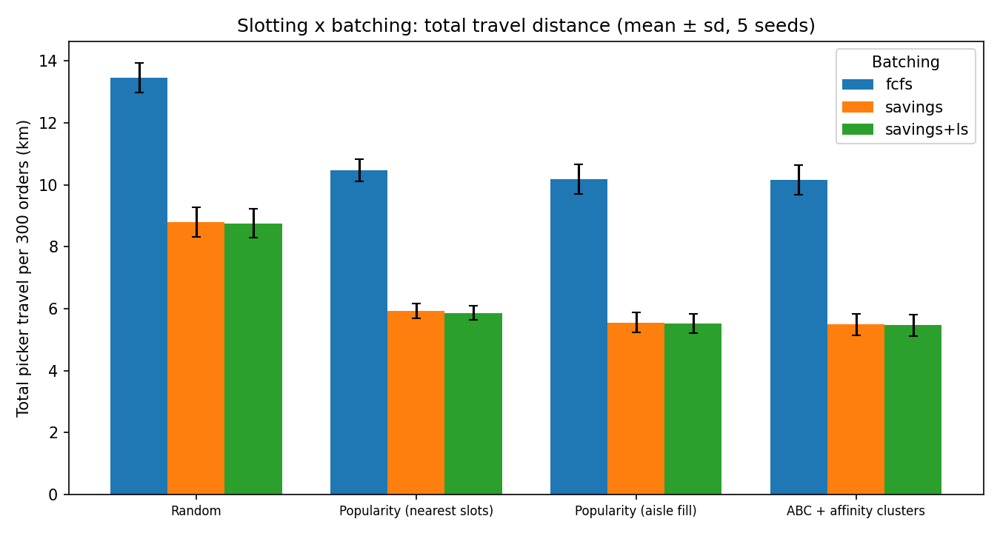
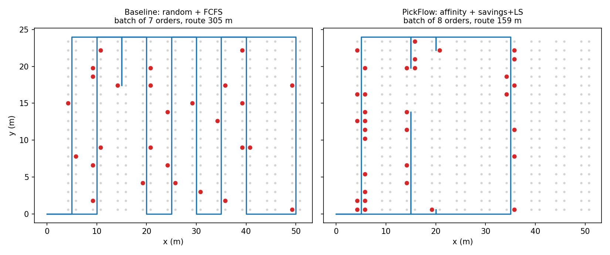
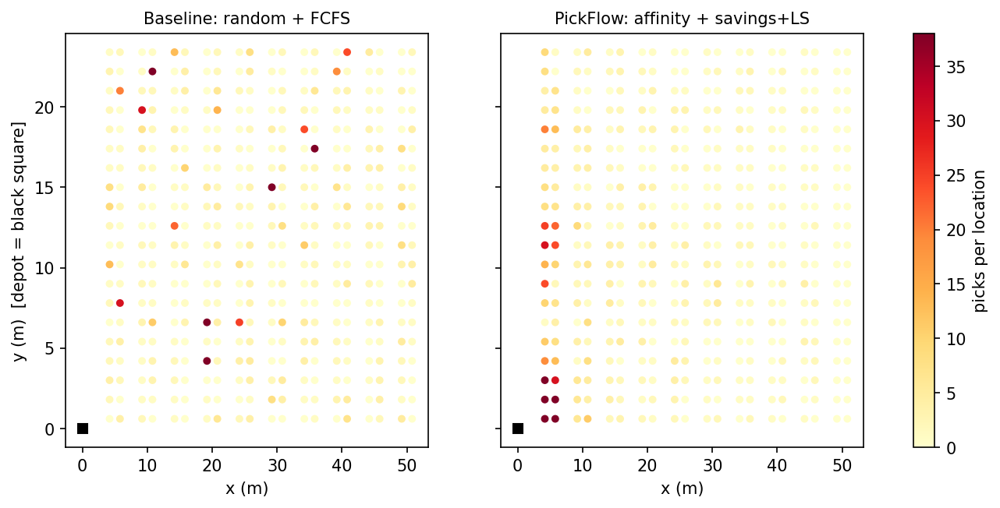
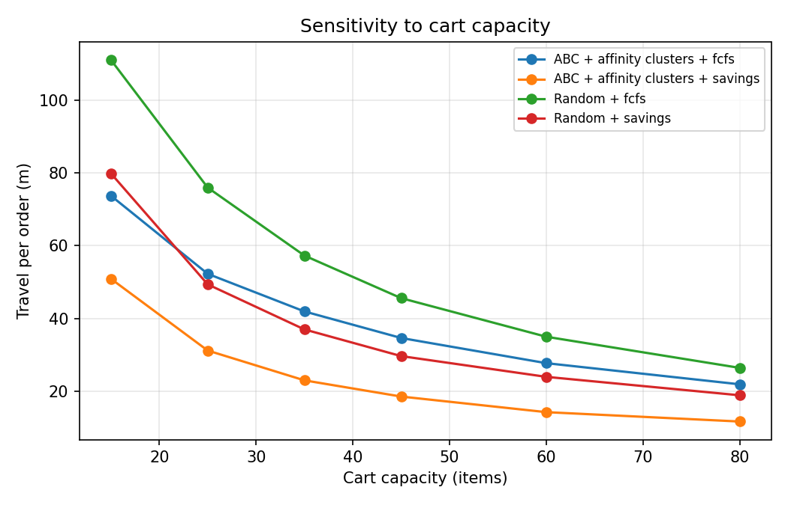

# PickFlow: Joint Slotting, Order Batching and Picker Routing

Order picking is often cited as around half of warehouse operating cost, and most of that is picker
**travel time**. PickFlow attacks it with three coupled decisions and quantifies how much each one
contributes:

| Decision | Question | Methods implemented |
|---|---|---|
| **Slotting** | Which SKU goes in which storage slot? | Random, popularity (nearest slots), popularity (aisle fill), **ABC + affinity clustering** |
| **Batching** | Which orders are picked together on one cart trip? | FCFS, **Clarke-Wright savings**, savings + **local search** (relocate/swap) |
| **Routing** | In what sequence does the picker visit the locations? | S-shape heuristic, **near-optimal TSP** (OR-Tools guided local search) |

The three interact: good slotting makes batches overlap in fewer aisles, and good batching makes
routes shorter. Optimising them separately leaves savings on the table.

## Setting

- Single-block warehouse: 10 parallel aisles, 40 slots each (shelves on both sides), front and back
  cross-aisles, depot at the front-left. 400 slots, 360 SKUs.
- Distances are **exact** aisle-based (rectilinear, via front or back cross-aisle), not Euclidean.
- Demand: Zipf SKU popularity (roughly 75% of picks from the top 20% of SKUs) and product-family
  affinity (65% of an order's lines come from one family). 300 orders per run, avg ~4 lines each.
- Slotting policies are learned from a separate **2,000-order history**, then evaluated on fresh
  orders, so there is no leakage.
- Cart capacity 45 items, 4 pickers, 1 m/s, 6 s per pick, 90 s setup per batch.
- Results are averaged over 5 random seeds.

## Results

Total picker travel for 300 orders (S-shape routing), mean of 5 seeds:

| Slotting | FCFS | Savings | Savings + LS |
|---|---|---|---|
| Random (baseline) | 13,458 m | 8,803 m | 8,756 m |
| Popularity (nearest slots) | 10,476 m | 5,918 m | 5,862 m |
| Popularity (aisle fill) | 10,191 m | 5,549 m | 5,525 m |
| **ABC + affinity** | 10,151 m | 5,492 m | **5,467 m** |

- **Best vs baseline: -59.4% travel distance** (13,458 m to 5,467 m), makespan with 4 pickers drops
  from 1.98 h to 1.39 h.
- Batching is the biggest single lever (about -35% to -46% at any slotting); slotting is second
  (about -22% to -24% under FCFS); they compound.
- Affinity-aware slotting adds only a small gain over simple aisle-based popularity slotting here
  (~1 pp). Most of the slotting value comes from concentrating hot SKUs in few aisles. Affinity
  matters more when demand is flatter or families are tighter (tunable in `data.py`).
- **TSP re-routing check (mean of 5 seeds).** Batches are built using the fast S-shape cost; each
  batch is then re-routed with a near-optimal OR-Tools TSP solve to see how much the simple rule
  loses. S-shape is **16.9% longer** than TSP on the random layout but only **3.9%** longer on
  the optimised layout, so good slotting makes the simple routing rule nearly optimal. With TSP
  routing for both sides, the full pipeline vs baseline is **-54.6%** (11,579 m to 5,253 m;
  sd 1.7 pp, range 52.6% to 56.6% across seeds).
- Savings grow with larger carts: affinity + savings travels 18.6 m/order at 45 items vs 29.7 m for
  random + savings (see `results/fig2_capacity.png`).






## Run it

```bash
python -m venv .venv && source .venv/bin/activate   # Windows: .venv\Scripts\activate
pip install -r requirements.txt
python run_experiments.py          # ~2 min; writes tables and figures to results/
```

## Structure

```
pickflow/
├── run_experiments.py      # experiments, tables, figures
├── requirements.txt
├── src/pickflow/
│   ├── layout.py           # warehouse geometry + exact distance matrix
│   ├── data.py             # synthetic catalogue and orders (Zipf + family affinity)
│   ├── slotting.py         # random / popularity / aisle-fill / ABC+affinity
│   ├── batching.py         # FCFS, Clarke-Wright savings, local search
│   ├── routing.py          # S-shape and OR-Tools TSP
│   └── evaluate.py         # distance, labour hours, multi-picker makespan
└── results/                # CSV tables + PNG figures
```

## Limitations and honest caveats

- Batching is optimised against the S-shape cost (instant to evaluate); TSP is used afterwards
  as a re-routing benchmark. It is not integrated into the batching search.
- Demand is synthetic. The structure (Zipf + affinity) mirrors published warehouse findings, but
  absolute numbers will differ on real order data. The pipeline accepts any `(skus, qty)` order list.
- Batching is heuristic (no optimality bound). A CP-SAT/MILP benchmark on small instances would
  quantify the gap.
- One block, two cross-aisles, one depot. No mid-aisle cross-aisles, one-way aisles or congestion.
- Slot capacity is one SKU per slot; no weight, size or replenishment constraints.

## Future work

- Real data (e.g. public e-commerce order logs) plus a warehouse-layout import.
- MILP/CP-SAT lower bounds for batching; ALNS metaheuristic.
- Time-window batching with due times / cut-offs (online, rolling horizon).
- Congestion-aware simulation with SimPy; replenishment and re-slotting cost.
- Zoning / wave picking, mid-aisle cross-aisles, and multiple depots.

## License

MIT
